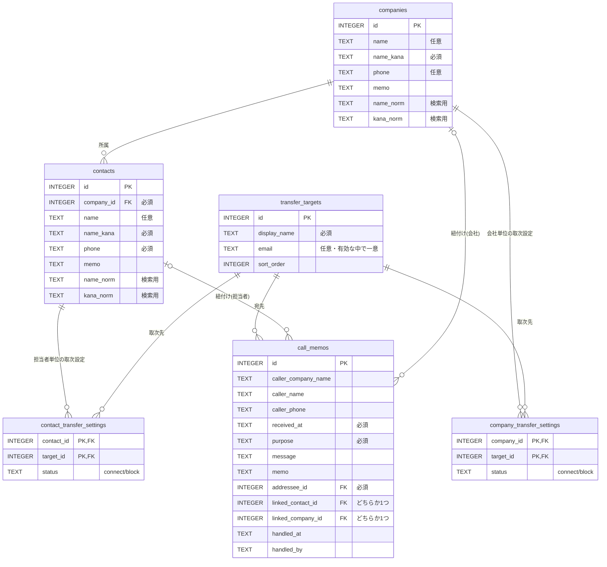

# 電話取次支援アプリ STEP1 DB設計

- 版: v0.2 / 作成日: 2026-11-18 / 更新日: 2026-11-24
- 元にした仕様: `docs/spec-step1.md` v0.5(主に 3章・5章・6章)。用語は `GLOSSARY.md` に従う。
- 対象DB: Cloudflare D1(SQLite)
- 本書は第6回(レビュー会③、11/20)に向けたDB設計(提出期限: 11/19 18:00、GitHubのリポジトリに置く)。第6回で決めた共通テーブル定義を反映済み(再提出期限: 11/25 19:00)。DDL案は付録Aに置く(マイグレーションは別途作成する)。

### 改訂履歴
- v0.2: 第6回勉強会(2026-11-20、レビュー会③)の「2. 共通テーブル定義の決定」を反映した(詳細は「第6回で決めた共通テーブル定義との対応」)。主な変更は以下。
  - 取次設定を「未設定」に戻したときは、行を物理削除する(論点1)。`status` の値から `'unset'` をなくした。
  - 取次設定の競合検知を、`version` から「確認画面を表示した時点の変更前の値」との比較に変えた(行を消すと版が残らないため)。取次設定の2テーブルから `version` を削除した。
  - 削除者(`deleted_by`)をなくした。削除した人は、削除時に更新する更新者(`updated_by`)で分かる(論点6)。
  - 会社の削除に連動して削除された担当者を、削除理由の列(`deleted_cause`)ではなく「会社と同じ削除日時」で見分ける(論点6)。`contacts.deleted_cause` を削除した。
- v0.1: 初版(第6回への提出版)。

### 第6回で決めた共通テーブル定義との対応

| # | 論点 | 第6回の決定 | 本書の対応 |
| --- | --- | --- | --- |
| 1 | 「未設定」に戻したときの持ち方 | 物理削除にする | **変更**。行を削除する(4.4) |
| 2 | 空値の表し方 | 合わせなくてよい | 変更なし。任意項目の未入力は `NULL`(1章の方針8) |
| 3 | 取次メモと相手の紐付け | 担当者IDか会社IDのどちらか一方。他は自由 | 変更なし。`linked_contact_id` / `linked_company_id` のどちらか一方(4.5) |
| 4 | 宛先と利用者の持ち方 | このまま(各自) | 変更なし。利用者テーブルなし、作業者はメールアドレス、取次先のメールアドレスは任意、マイグレーションで投入(4.3) |
| 5 | 対処済みの持ち方 | 対処日時・対処者のみ。対処日時の有無で判断(状態の列なし) | 変更なし(4.6) |
| 6 | 論理削除の持ち方 | 削除者はなし(更新者で足りる)。連動削除した担当者は会社と同じ削除日時で見分ける | **変更**。`deleted_by` と `deleted_cause` を削除(3.2、6.3) |
| 7 | 共通カラムの範囲 | 各自自由 | 変更なし。作成者・更新者・`version`・`request_token` を持つ(3.1、4.7) |

### 第5回で決めた形式・含める内容との対応

| 第5回の決定 | 本書の該当箇所 |
| --- | --- |
| 形式: マークダウン | 本書(`docs/db-design-step1.md`) |
| ER図(形式は自由) | 2.2(Mermaid) |
| テーブル一覧 | 2.1 |
| カラム名・型・必須・制約 | 3.1(共通カラム)、4章(テーブルごと)、付録A(DDL案) |
| 論理削除の持ち方 | 3.2 |
| 取次設定(会社単位・担当者単位)の持ち方 | 4.4 |

---

## 1. 設計方針

| # | 方針 | 根拠 |
| --- | --- | --- |
| 1 | 取次先はマスタテーブルに持つ。追加・編集の画面は作らないため、初期4名はマイグレーション(またはシード)で投入する | 3章、5.3 |
| 2 | 取次設定は **会社用と担当者用の2テーブル** に分ける。1行=「対象 × 取次先」の1組で、行があるのは「つなぐ」「つながない」のときだけ。行が無い組は「未設定」とみなす。「未設定」に戻した場合は行を物理削除する | 5.4.1、6.1、第6回 論点1 |
| 3 | 論理削除は、取次設定以外のテーブルで `deleted_at` を持つ。`deleted_at IS NULL` が「有効」。削除者の列は持たず、削除時の更新者(`updated_by`)で分かる | 5.3、6.5、第6回 論点6 |
| 4 | 会社の削除に連動して削除された担当者は、会社と同じ `deleted_at` で識別する | 5.3、AC-DEL-04、第6回 論点6 |
| 5 | 競合検知は `version`(整数、更新ごとに+1)。`UPDATE ... WHERE id = ? AND version = ?` の更新件数が0なら競合。取次設定だけは変更前の値と比べる(4.4) | 5.0 |
| 6 | 作成者・更新者・対処者は、JWTのメールアドレスを文字列で持つ。ユーザーテーブルは作らない | 5.1、5.7 |
| 7 | 日時はすべて UTC の ISO 8601 文字列(`YYYY-MM-DDTHH:MM:SSZ`)で保存し、表示時にJSTへ変換する | 5.7、テンプレートの `items` テーブルと同じ形式 |
| 8 | 電話番号は数字のみの `TEXT`(先頭0を保持)。任意項目の未入力は空文字ではなく `NULL` で持つ | 6.3 |
| 9 | 検索用に正規化した値を別カラムで持つ(D1/SQLiteではNFKC・ひらがな統一ができないため、保存時にアプリで計算する) | 5.5、6.4 |
| 10 | 取次メモの相手情報は取次メモ側にコピーして持つ。紐付け(担当者か会社のどちらか1つ)は別カラムの外部キーで持つ | 5.6.1、6.2 |
| 11 | 入力チェックの主体はアプリ。DBのCHECK制約は「壊れたデータを入れない」最後の防御線として、表現しやすいものだけ置く | — |

### 1.1 呼び名の対応(仕様の用語 → DB名)

| 仕様の用語 | テーブル / カラム |
| --- | --- |
| 会社 | `companies` |
| 担当者 | `contacts` |
| 取次先 | `transfer_targets` |
| 取次設定(会社単位) | `company_transfer_settings` |
| 取次設定(担当者単位) | `contact_transfer_settings` |
| 取次メモ | `call_memos` |
| 宛先 | `call_memos.addressee_id`(→ `transfer_targets.id`) |
| 紐付け | `call_memos.linked_contact_id` / `call_memos.linked_company_id` |
| 受電者 | `call_memos.created_by`(専用カラムは持たない) |
| 受電日時 | `call_memos.received_at` |
| 用件 | `call_memos.purpose` |
| 伝言 | `call_memos.message` |
| 対処済み・対処日時・対処者 | `call_memos.handled_at` / `call_memos.handled_by`(4.6参照) |
| つなぐ / つながない / 未設定 | `'connect'` / `'block'` / 行なし |
| 折り返し希望 / 連絡があったことをお伝え希望 / 伝言希望 | `'callback'` / `'notify'` / `'message'` |

---

## 2. テーブル一覧とER図

### 2.1 テーブル一覧

| # | テーブル | 内容 | 論理削除 | 詳細 |
| --- | --- | --- | --- | --- |
| 1 | `companies` | 会社 | あり | 4.1 |
| 2 | `contacts` | 担当者(会社に所属) | あり(会社の削除に連動) | 4.2 |
| 3 | `transfer_targets` | 取次先(社長・菊地・益岡・木村) | あり | 4.3 |
| 4 | `company_transfer_settings` | 取次設定(会社単位)。会社 × 取次先ごとに最大1行 | なし(「未設定」に戻すと物理削除。対象の論理削除では残す) | 4.4 |
| 5 | `contact_transfer_settings` | 取次設定(担当者単位)。担当者 × 取次先ごとに最大1行 | なし(同上) | 4.4 |
| 6 | `call_memos` | 取次メモ | あり | 4.5 |

ユーザー(ログインする人)のテーブルは作らない。作成者・更新者などはJWTのメールアドレスを文字列で持つ(1章の方針6)。

### 2.2 ER図



(共通カラム(3章)は図から省略)

---

## 3. 共通カラムと論理削除の持ち方

### 3.1 共通カラム

すべてのテーブルに以下を持つ。取次設定の2テーブルは `deleted_at` と `version` を持たない(4.4)。共通カラムの範囲は各自に任せることになった(第6回 論点7)ため、以下は本人の設計。

| カラム | 型 | 必須 | 制約・説明 |
| --- | --- | --- | --- |
| `version` | INTEGER | ○ | 既定値 1。更新(編集・削除・対処済み切り替え)のたびに+1。競合検知に使う |
| `created_by` | TEXT | ○ | 作成者のメールアドレス(JWT) |
| `created_at` | TEXT | ○ | 作成日時(UTC ISO 8601)。既定値は現在時刻 |
| `updated_by` | TEXT | ○ | 最終更新者のメールアドレス。作成時は `created_by` と同じ。**削除したときは削除した人になる** |
| `updated_at` | TEXT | ○ | 最終更新日時。作成時は `created_at` と同じ |
| `deleted_at` | TEXT | — | 削除日時。有効なら NULL。**`deleted_at IS NULL` を「有効」の判定に使う** |

- 削除も更新の一種として `updated_by` / `updated_at` / `version` を更新する(5.7)。削除者の専用カラムは持たない(第6回 論点6)。
- 変更履歴(変更前後の値)は持たない(5.7)。

### 3.2 論理削除の持ち方

| 項目 | 持ち方 |
| --- | --- |
| 対象テーブル | `companies` / `contacts` / `transfer_targets` / `call_memos` |
| 削除状態 | `deleted_at`(削除日時)のみ。**`deleted_at IS NULL` が「有効」**。削除フラグの専用カラムは持たない(日時と食い違わないようにするため) |
| 削除者 | 専用カラムは持たない。削除時に `updated_by` を削除した人で更新するので、削除後に他の更新がない限り `updated_by` が削除者になる(削除済みのデータは画面から編集できないため、通常は上書きされない) |
| 削除時の更新 | `deleted_at` に加えて、`updated_at` / `updated_by` / `version` も更新する。`updated_at` と `deleted_at` は同じ値にする |
| 会社の削除に連動した担当者 | **会社と同じ `deleted_at`** で識別する。会社の削除と、その担当者の連動削除は同じ日時の値で書き込む(6.3)。先に個別削除された担当者は、その時点の削除日時が残るので区別できる(AC-DEL-04) |
| 取次設定 | 論理削除しない(`deleted_at` を持たない)。会社・担当者・取次先が削除されても行は残し、読むときに対象・取次先の `deleted_at` で除く。「未設定」に戻したときだけ行を物理削除する(4.4) |
| 削除済みへの参照 | 取次メモの紐付け(`linked_*`)・宛先(`addressee_id`)は、参照先が削除済みでも外部キーのまま維持する。新たに参照するときだけ、有効であることをアプリで確認する |
| 検索・一覧 | すべての検索・一覧・「優先」の判定・自分宛て件数に `deleted_at IS NULL` の条件を付ける。インデックスも `WHERE deleted_at IS NULL` の部分インデックスにする(5章) |
| 物理削除・復元 | アプリでは提供しない。復旧はDBを直接操作し、`deleted_at` を NULL に戻す。会社を復旧するときは、`company_id` が同じで `deleted_at` が会社と同じ担当者も戻す |

---

## 4. テーブル定義

### 4.1 `companies`(会社)

| カラム | 型 | 必須 | 制約・説明 |
| --- | --- | --- | --- |
| `id` | INTEGER | ○ | PK(AUTOINCREMENT) |
| `name` | TEXT | — | 会社名。100文字以内。前後の空白は除去して保存。空なら NULL |
| `name_kana` | TEXT | ○ | 会社名よみがな。ひらがな・長音・空白のみ(カタカナは保存時にひらがなへ変換)。100文字以内 |
| `phone` | TEXT | — | 電話番号。半角数字のみ、1〜15桁。空なら NULL |
| `memo` | TEXT | — | 1,000文字以内 |
| `name_norm` | TEXT | — | 検索・重複判定用の会社名(下記の正規化)。`name` が NULL なら NULL |
| `kana_norm` | TEXT | ○ | 検索・重複判定用のよみがな(下記の正規化) |
| `request_token` | TEXT | — | 二重送信抑止用。UNIQUE(4.7) |
| 共通カラム | | | 3章 |

- 表示名: `COALESCE(name, name_kana)`(会社名が空ならよみがな)。
- 重複判定(5.2.1、警告して確認すれば保存可)はアプリで行う。対象は有効な会社の `name_norm` / `kana_norm` / `phone`。

**正規化(`*_norm`)のルール**(アプリで保存時に計算):
NFKC(全角半角の統一)→ 空白(半角・全角)の除去 → 英字を小文字化 → カタカナをひらがなに変換。
検索語にも同じ正規化をかけて `LIKE '%…%'` で部分一致させる(5.5)。

### 4.2 `contacts`(担当者)

| カラム | 型 | 必須 | 制約・説明 |
| --- | --- | --- | --- |
| `id` | INTEGER | ○ | PK |
| `company_id` | INTEGER | ○ | FK → `companies.id`。所属会社。新規・変更時は有効な会社のみ(アプリで確認) |
| `name` | TEXT | — | 担当者名(氏名)。50文字以内。空なら NULL |
| `name_kana` | TEXT | ○ | 担当者名よみがな。会社名よみがなと同じ規則。50文字以内 |
| `phone` | TEXT | ○ | 電話番号。半角数字のみ、1〜15桁 |
| `memo` | TEXT | — | 1,000文字以内 |
| `name_norm` | TEXT | — | 検索・重複判定用の氏名 |
| `kana_norm` | TEXT | ○ | 検索・重複判定用のよみがな |
| `request_token` | TEXT | — | 二重送信抑止用。UNIQUE |
| 共通カラム | | | 3章 |

- 会社の削除に連動して削除された担当者は、所属会社と同じ `deleted_at` を持つ(3.2)。
- 表示名: `COALESCE(name, name_kana)`。
- 所属会社の変更(Q-23)は `company_id` の更新のみ。担当者の取次設定は `contact_id` に付いているので、そのまま維持される。
- 重複判定(5.2.2)はアプリで行う:
  - 登録不可: 同じ `company_id` の有効な担当者で、(`name_norm` 一致 または `kana_norm` 一致)かつ `phone` 一致。
  - 警告: 他の有効な担当者(別会社を含む)と `phone` 一致。
  - 「または」を含むため一意制約では表現できない。データ量が小さい(担当者2,000件程度)ので登録時の検索で十分。

### 4.3 `transfer_targets`(取次先)

| カラム | 型 | 必須 | 制約・説明 |
| --- | --- | --- | --- |
| `id` | INTEGER | ○ | PK |
| `display_name` | TEXT | ○ | 表示名(社長・菊地・益岡・木村) |
| `email` | TEXT | — | ログインユーザーとの対応に使うメールアドレス。任意。**有効な取次先の中で一意、大文字・小文字を区別しない**(部分一意インデックス、5章) |
| `sort_order` | INTEGER | ○ | 画面での並び順(取次設定の表・宛先の選択肢)。既定値 0 |
| 共通カラム | | | 3章 |

- 追加・編集の画面は作らない。初期4名はマイグレーションで投入し、変更はDB直接で行う(5.3)。
- 削除済みの取次先は宛先の選択肢・取次設定の表示・自分宛ての判定から除く。既存の取次メモからの参照は外部キーのまま残るため、宛先名は `display_name` をそのまま表示できる(宛先名のコピーは持たない)。
- 自分宛ての判定: `email = :jwt_email COLLATE NOCASE AND deleted_at IS NULL`。

### 4.4 取次設定(会社単位・担当者単位)の持ち方: `company_transfer_settings` / `contact_transfer_settings`

- 会社単位は `company_transfer_settings`、担当者単位は `contact_transfer_settings` に持つ。
- 1行 = 「対象(会社または担当者)× 取次先」の1組。状態は つなぐ / つながない / 未設定 の3つで、**行があるのは「つなぐ」「つながない」のときだけ**。行が無ければ「未設定」。
- 会社単位と担当者単位は独立に設定でき、検索結果では両方を並べて「優先」を決める(6.1)。

2テーブルは対象のカラム以外は同じ構造。

| カラム | 型 | 必須 | 制約・説明 |
| --- | --- | --- | --- |
| `company_id` / `contact_id` | INTEGER | ○ | FK → `companies.id` / `contacts.id`。PKの一部 |
| `target_id` | INTEGER | ○ | FK → `transfer_targets.id`。PKの一部 |
| `status` | TEXT | ○ | `'connect'`(つなぐ)/ `'block'`(つながない)。未設定の値は持たない |
| `created_by` / `created_at` / `updated_by` / `updated_at` | TEXT | ○ | 3章と同じ |

- PK: (`company_id`, `target_id`) / (`contact_id`, `target_id`)。1組につき最大1行。
- `deleted_at` は持たない。会社・担当者・取次先が論理削除されても行は残す(5.3)。表示時に対象・取次先の `deleted_at` で絞る。
- `version` は持たない(競合検知は下記のとおり変更前の値で行う)。

**2テーブルに分けた理由**
1テーブルに `company_id` と `contact_id` の両方を持たせる案(どちらか一方だけ入れる)もあるが、以下の理由で分けた。
- 両方の外部キーを効かせつつ、PKを素直に「対象 × 取次先」にできる(1テーブル案だとPKの代わりに部分一意インデックスが2本と、排他のCHECKが必要)。
- 会社設定と担当者設定は画面も置き場所も別(S-02 / S-03)で、同時に更新することがない。
- 検索結果の「両方表示」は LEFT JOIN 2本で取れる(6.1)。

**「未設定」の扱い**(第6回 論点1)
| 状態 | DB上の表現 |
| --- | --- |
| 一度も設定していない(新しい会社・担当者、DBで追加した取次先) | 行なし |
| 「つなぐ」「つながない」から「未設定」に戻した | 行を物理削除 → 行なし |

どちらも読むときは `COALESCE(status, 'unset')` で「未設定」として扱う(6.1)。「未設定」に戻した人・日時は残らない(行ごと消えるため)。

**設定変更と競合検知**
行を物理削除すると版が残らないため、取次設定だけは `version` ではなく、**確認画面を表示した時点の変更前の値**(つなぐ / つながない / 未設定)と、保存時点の現在の値を比べる(仕様5.0「つなぐ設定の変更は、確認画面を表示した時点の変更前の値を基準にする」)。

| 変更前 → 変更後 | SQL | 競合の判定 |
| --- | --- | --- |
| 未設定 → つなぐ / つながない | `INSERT ... ON CONFLICT DO NOTHING` | 挿入件数が0なら、他の人が先に設定したので競合 |
| つなぐ ⇔ つながない | `UPDATE ... SET status = :after, updated_by = ?, updated_at = ? WHERE company_id = ? AND target_id = ? AND status = :before` | 更新件数が0なら競合 |
| つなぐ / つながない → 未設定 | `DELETE FROM ... WHERE company_id = ? AND target_id = ? AND status = :before` | 削除件数が0なら競合 |

- 対象の会社・担当者、取次先が有効であることは同じトランザクション(D1の `batch`)内で確認する。

### 4.5 `call_memos`(取次メモ)

| カラム | 型 | 必須 | 制約・説明 |
| --- | --- | --- | --- |
| `id` | INTEGER | ○ | PK |
| `caller_company_name` | TEXT | 条件付き | 相手の会社名。100文字以内 |
| `caller_name` | TEXT | 条件付き | 相手の氏名。50文字以内 |
| `caller_phone` | TEXT | 条件付き | 相手の電話番号。半角数字のみ、1〜15桁。用件が折り返し希望のとき必須 |
| `received_at` | TEXT | ○ | 受電日時(UTC ISO 8601、分単位で秒は `00`)。未来不可はアプリで確認 |
| `purpose` | TEXT | ○ | 用件。`'callback'` / `'notify'` / `'message'` |
| `message` | TEXT | 条件付き | 伝言。1,000文字以内。用件が伝言希望のとき必須 |
| `memo` | TEXT | — | メモ。1,000文字以内 |
| `addressee_id` | INTEGER | ○ | 宛先。FK → `transfer_targets.id`。新規・付け替え時は有効な取次先のみ(アプリで確認)。宛先を変えない編集では削除済みの取次先のまま保存できる |
| `linked_contact_id` | INTEGER | — | 紐付け(担当者)。FK → `contacts.id` |
| `linked_company_id` | INTEGER | — | 紐付け(会社)。FK → `companies.id`。担当者を紐付けたときは NULL(会社は担当者からたどる) |
| `handled_at` | TEXT | — | 対処日時。未対処なら NULL |
| `handled_by` | TEXT | — | 対処者のメールアドレス。未対処なら NULL |
| `request_token` | TEXT | — | 二重送信抑止用。UNIQUE |
| 共通カラム | | | 3章。`created_by` が受電者を表す |

CHECK制約(仕様の必須条件のうちDBで表現できるもの):
- 相手情報は1つ以上: `caller_company_name IS NOT NULL OR caller_name IS NOT NULL OR caller_phone IS NOT NULL`
- 折り返し希望なら電話番号必須: `purpose <> 'callback' OR caller_phone IS NOT NULL`
- 伝言希望なら伝言必須: `purpose <> 'message' OR message IS NOT NULL`
- 紐付けはどちらか1つまで: `linked_contact_id IS NULL OR linked_company_id IS NULL`
- 対処日時と対処者はそろって入る: `(handled_at IS NULL) = (handled_by IS NULL)`

紐付けの扱い(5.6.1):
- 紐付け先の担当者・会社が削除・変更されても、紐付けのカラムは変更しない。相手情報(`caller_*`)は入力どおりに保存し、紐付け先から再取得しない。
- 未登録の相手を後から登録したときは、遷移元の取次メモ1件の `linked_contact_id`(会社のみ登録した場合は `linked_company_id`)を更新する。遷移元のメモIDは登録フォームの隠し項目で受け渡す(DBに専用カラムは持たない)。

### 4.6 対処済みの持ち方

対処済みフラグの専用カラムは持たず、**`handled_at IS NOT NULL` を「対処済み」とする**。

- 対処済みにする: `handled_at` = 現在時刻、`handled_by` = ログインユーザー、`version + 1`。
- 未対処に戻す: `handled_at` / `handled_by` を NULL、`version + 1`。
- 対処済みのまま他の項目を編集: `handled_at` / `handled_by` は変更しない(Q-34)。

フラグを別に持つと「フラグは対処済みなのに対処日時が空」という矛盾が起こりうるため、1つの値から導く。共通ダミーデータ(CSV)で「対処済み」列が必要なら、`handled_at` の有無から出力する。

### 4.7 二重送信の抑止

新規登録の画面を表示するときにランダムなトークン(UUID)を発行してフォームに埋め込み、`request_token` に保存する。同じトークンで2回送信されると UNIQUE 制約で2件目が失敗するので、既存の1件を結果として返す。対象は新規登録のある `companies` / `contacts` / `call_memos`。編集・削除・切り替えの二重送信は `version` の競合検知で防げる。

---

## 5. インデックス

| テーブル | インデックス | 用途 |
| --- | --- | --- |
| `companies` | `(kana_norm) WHERE deleted_at IS NULL` | 検索結果の並び順(よみがな昇順) |
| `companies` | `(phone) WHERE deleted_at IS NULL` | 電話番号の完全一致(取次メモの候補、重複警告、並び順①) |
| `contacts` | `(company_id, kana_norm) WHERE deleted_at IS NULL` | 会社詳細の担当者一覧、検索結果での展開 |
| `contacts` | `(phone) WHERE deleted_at IS NULL` | 電話番号の完全一致 |
| `transfer_targets` | UNIQUE `(email COLLATE NOCASE) WHERE deleted_at IS NULL AND email IS NOT NULL` | メールアドレスの一意性(有効な中で、大文字・小文字を区別しない) |
| `call_memos` | `(addressee_id, received_at DESC) WHERE deleted_at IS NULL AND handled_at IS NULL` | 自分宛ての未対処の件数(全画面ヘッダー)・初期表示の一覧 |
| `call_memos` | `(received_at DESC) WHERE deleted_at IS NULL` | 一覧(受電日時の新しい順) |
| `call_memos` | `(linked_contact_id)` / `(linked_company_id)` | 担当者・会社詳細から関連メモをたどる場合 |
| 取次設定2テーブル | PK、および `(target_id)` | 取次先単位の参照(取次先削除時の影響確認など) |

- 名前・よみがな・電話番号の**部分一致**検索は `LIKE '%…%'` でインデックスが効かない。想定データ量(会社500件・担当者2,000件)では全件走査で1秒以内に収まる見込み(7.3)。
- `request_token` は UNIQUE 制約で自動的にインデックスが作られる。

---

## 6. 代表的な読み書き

### 6.1 検索結果の取次設定(会社設定・担当者設定・「優先」)

```sql
SELECT
  t.id                                   AS target_id,
  t.display_name,
  COALESCE(cs.status, 'unset')           AS company_status,
  COALESCE(ps.status, 'unset')           AS contact_status,
  CASE
    WHEN ps.status IS NOT NULL THEN 'contact'   -- 担当者設定あり
    WHEN cs.status IS NOT NULL THEN 'company'   -- 担当者が未設定で会社設定あり
    ELSE NULL                                     -- 両方未設定: 優先なし
  END                                    AS preferred_side
FROM transfer_targets t
LEFT JOIN company_transfer_settings cs
  ON cs.target_id = t.id AND cs.company_id = :company_id
LEFT JOIN contact_transfer_settings ps
  ON ps.target_id = t.id AND ps.contact_id = :contact_id
WHERE t.deleted_at IS NULL
ORDER BY t.sort_order, t.id;
```

「優先」の規則(5.4.3)はこの `CASE` で表す。会社のみ特定できた場合は `:contact_id` に NULL を渡せば担当者側がすべて未設定になる。

### 6.2 自分宛ての未対処件数(全画面ヘッダー)

```sql
SELECT COUNT(*)
FROM call_memos m
JOIN transfer_targets t ON t.id = m.addressee_id
WHERE t.email = :jwt_email COLLATE NOCASE
  AND t.deleted_at IS NULL
  AND m.deleted_at IS NULL
  AND m.handled_at IS NULL;
```

### 6.3 会社の削除(担当者の連動削除)

D1の `batch` で1トランザクションにまとめる。

`:now` はアプリで1回だけ取得し、両方の文に同じ値を渡す。

```sql
-- 1) 会社(版を確認)
UPDATE companies
SET deleted_at = :now, updated_at = :now, updated_by = :user, version = version + 1
WHERE id = :id AND version = :version AND deleted_at IS NULL;

-- 2) 有効な所属担当者を連動削除(1) が0件なら実行しない)
UPDATE contacts
SET deleted_at = :now, updated_at = :now, updated_by = :user, version = version + 1
WHERE company_id = :id AND deleted_at IS NULL;
```

連動削除した担当者は会社と同じ `deleted_at` を持ち、先に個別削除された担当者はそれより前の `deleted_at` のまま変わらないので、DB直接の復旧で区別できる(AC-DEL-04)。取次設定の行は消さない。

```sql
-- 会社 :id と一緒に削除された担当者
SELECT ct.*
FROM contacts ct
JOIN companies co ON co.id = ct.company_id
WHERE co.id = :id AND ct.deleted_at = co.deleted_at;
```

注: 日時は秒単位のため、個別削除と会社の削除が同じ秒に起きると区別できない。人が画面で確認してから削除するので、実運用では起きないものとして扱う。

---

## 7. DBでは守らず、アプリで守るルール

| ルール | 理由 |
| --- | --- |
| 受電日時が未来でない | SQLiteのCHECKでは現在時刻を使えない |
| よみがなの文字種(ひらがな・長音・空白のみ)、電話番号以外の文字数上限の超過時のメッセージ | 入力エラーは項目の近くに文言付きで出すため(5.0)。文字数・電話番号の形式はDBのCHECKでも二重に守る |
| 新たに参照する会社・担当者・取次先が有効であること | 外部キーは削除済みの行も指すため。既存の参照(紐付け・宛先)は削除済みでも維持する必要がある |
| 会社・担当者の重複判定(警告・登録不可) | 「または」を含む条件で一意制約にできない(4.2) |
| 競合検知 | `WHERE version = ?`(取次設定は `WHERE status = :before`)の更新件数で判定する |
| 更新者は JWT の値のみ使う | クライアントの送信値を使わない(5.1) |

---

## 8. 仕様の未決事項との関係

| ID | 内容 | DB設計への影響 |
| --- | --- | --- |
| Q-32 | 取次メモの入力項目(益岡さんのモック)との差異 | `call_memos` のカラムが増減する可能性あり。受電者の欄がモックにあれば `received_by` を追加する |
| Q-06 | 「未設定」の意味 | 影響なし(「未設定」は行なしで表すだけで、既定動作はDBに持たない) |
| Q-03 / Q-04 | 同一人物・重複の照合ルール | 正規化カラム(`*_norm`)の作り方が変わる可能性あり。テーブル構造は変わらない |
| Q-01 | 未設定の記録 | 第6回 論点1で「物理削除」に決まった。仕様書v0.5の方針(「未設定」も記録し更新者を残す。5.4.1、5.7、AC-RULE-20/21)は、仕様書側の修正が必要 |
| Q-02 / Q-33 | 担当者未設定時の優先、取次先の削除 | 第6回の議題2では論点にならなかった。本書は仕様書v0.5の方針のまま(6.1の `CASE`、`transfer_targets.deleted_at`) |
| (削除者) | 削除者の記録 | 第6回 論点6で「削除者の列なし、更新者で足りる」に決まった。仕様書の「削除日時・削除者を記録する」(5.3、5.7、AC-DEL-02)は、削除者=削除時の更新者と読み替える形で仕様書側の修正が必要 |
| Q-25 | 物理削除・保管期間 | STEP1では物理削除しない前提。決まり次第、削除手順を別途定める |

STEP2への拡張(11章)は、Slackユーザー識別子を `transfer_targets` に、迷惑電話の判定フラグを `companies` / `contacts` に、着信記録を別テーブルに追加する形で、既存カラムを変えずに対応できる。

---

## 付録A. DDL案

マイグレーション作成時の下書き。`CHECK` はアプリの入力チェックの後ろにある最後の防御線。

```sql
CREATE TABLE companies (
  id            INTEGER PRIMARY KEY AUTOINCREMENT,
  name          TEXT CHECK (name IS NULL OR length(name) BETWEEN 1 AND 100),
  name_kana     TEXT NOT NULL CHECK (length(name_kana) BETWEEN 1 AND 100),
  phone         TEXT CHECK (phone IS NULL OR (length(phone) BETWEEN 1 AND 15 AND phone NOT GLOB '*[^0-9]*')),
  memo          TEXT CHECK (memo IS NULL OR length(memo) <= 1000),
  name_norm     TEXT,
  kana_norm     TEXT NOT NULL,
  request_token TEXT UNIQUE,
  version       INTEGER NOT NULL DEFAULT 1,
  created_by    TEXT NOT NULL,
  created_at    TEXT NOT NULL DEFAULT (strftime('%Y-%m-%dT%H:%M:%SZ', 'now')),
  updated_by    TEXT NOT NULL,
  updated_at    TEXT NOT NULL DEFAULT (strftime('%Y-%m-%dT%H:%M:%SZ', 'now')),
  deleted_at    TEXT
);

CREATE TABLE contacts (
  id            INTEGER PRIMARY KEY AUTOINCREMENT,
  company_id    INTEGER NOT NULL REFERENCES companies(id),
  name          TEXT CHECK (name IS NULL OR length(name) BETWEEN 1 AND 50),
  name_kana     TEXT NOT NULL CHECK (length(name_kana) BETWEEN 1 AND 50),
  phone         TEXT NOT NULL CHECK (length(phone) BETWEEN 1 AND 15 AND phone NOT GLOB '*[^0-9]*'),
  memo          TEXT CHECK (memo IS NULL OR length(memo) <= 1000),
  name_norm     TEXT,
  kana_norm     TEXT NOT NULL,
  request_token TEXT UNIQUE,
  version       INTEGER NOT NULL DEFAULT 1,
  created_by    TEXT NOT NULL,
  created_at    TEXT NOT NULL DEFAULT (strftime('%Y-%m-%dT%H:%M:%SZ', 'now')),
  updated_by    TEXT NOT NULL,
  updated_at    TEXT NOT NULL DEFAULT (strftime('%Y-%m-%dT%H:%M:%SZ', 'now')),
  deleted_at    TEXT
);

CREATE TABLE transfer_targets (
  id            INTEGER PRIMARY KEY AUTOINCREMENT,
  display_name  TEXT NOT NULL,
  email         TEXT,
  sort_order    INTEGER NOT NULL DEFAULT 0,
  version       INTEGER NOT NULL DEFAULT 1,
  created_by    TEXT NOT NULL,
  created_at    TEXT NOT NULL DEFAULT (strftime('%Y-%m-%dT%H:%M:%SZ', 'now')),
  updated_by    TEXT NOT NULL,
  updated_at    TEXT NOT NULL DEFAULT (strftime('%Y-%m-%dT%H:%M:%SZ', 'now')),
  deleted_at    TEXT
);

CREATE TABLE company_transfer_settings (
  company_id    INTEGER NOT NULL REFERENCES companies(id),
  target_id     INTEGER NOT NULL REFERENCES transfer_targets(id),
  status        TEXT NOT NULL CHECK (status IN ('connect', 'block')),
  created_by    TEXT NOT NULL,
  created_at    TEXT NOT NULL DEFAULT (strftime('%Y-%m-%dT%H:%M:%SZ', 'now')),
  updated_by    TEXT NOT NULL,
  updated_at    TEXT NOT NULL DEFAULT (strftime('%Y-%m-%dT%H:%M:%SZ', 'now')),
  PRIMARY KEY (company_id, target_id)
);

CREATE TABLE contact_transfer_settings (
  contact_id    INTEGER NOT NULL REFERENCES contacts(id),
  target_id     INTEGER NOT NULL REFERENCES transfer_targets(id),
  status        TEXT NOT NULL CHECK (status IN ('connect', 'block')),
  created_by    TEXT NOT NULL,
  created_at    TEXT NOT NULL DEFAULT (strftime('%Y-%m-%dT%H:%M:%SZ', 'now')),
  updated_by    TEXT NOT NULL,
  updated_at    TEXT NOT NULL DEFAULT (strftime('%Y-%m-%dT%H:%M:%SZ', 'now')),
  PRIMARY KEY (contact_id, target_id)
);

CREATE TABLE call_memos (
  id                  INTEGER PRIMARY KEY AUTOINCREMENT,
  caller_company_name TEXT CHECK (caller_company_name IS NULL OR length(caller_company_name) BETWEEN 1 AND 100),
  caller_name         TEXT CHECK (caller_name IS NULL OR length(caller_name) BETWEEN 1 AND 50),
  caller_phone        TEXT CHECK (caller_phone IS NULL OR (length(caller_phone) BETWEEN 1 AND 15 AND caller_phone NOT GLOB '*[^0-9]*')),
  received_at         TEXT NOT NULL,
  purpose             TEXT NOT NULL CHECK (purpose IN ('callback', 'notify', 'message')),
  message             TEXT CHECK (message IS NULL OR length(message) BETWEEN 1 AND 1000),
  memo                TEXT CHECK (memo IS NULL OR length(memo) <= 1000),
  addressee_id        INTEGER NOT NULL REFERENCES transfer_targets(id),
  linked_contact_id   INTEGER REFERENCES contacts(id),
  linked_company_id   INTEGER REFERENCES companies(id),
  handled_at          TEXT,
  handled_by          TEXT,
  request_token       TEXT UNIQUE,
  version             INTEGER NOT NULL DEFAULT 1,
  created_by          TEXT NOT NULL,
  created_at          TEXT NOT NULL DEFAULT (strftime('%Y-%m-%dT%H:%M:%SZ', 'now')),
  updated_by          TEXT NOT NULL,
  updated_at          TEXT NOT NULL DEFAULT (strftime('%Y-%m-%dT%H:%M:%SZ', 'now')),
  deleted_at          TEXT,
  CHECK (caller_company_name IS NOT NULL OR caller_name IS NOT NULL OR caller_phone IS NOT NULL),
  CHECK (purpose <> 'callback' OR caller_phone IS NOT NULL),
  CHECK (purpose <> 'message' OR message IS NOT NULL),
  CHECK (linked_contact_id IS NULL OR linked_company_id IS NULL),
  CHECK ((handled_at IS NULL) = (handled_by IS NULL))
);

-- インデックス
CREATE INDEX idx_companies_kana   ON companies (kana_norm) WHERE deleted_at IS NULL;
CREATE INDEX idx_companies_phone  ON companies (phone)     WHERE deleted_at IS NULL;
CREATE INDEX idx_contacts_company ON contacts (company_id, kana_norm) WHERE deleted_at IS NULL;
CREATE INDEX idx_contacts_phone   ON contacts (phone)      WHERE deleted_at IS NULL;
CREATE UNIQUE INDEX uq_transfer_targets_email
  ON transfer_targets (email COLLATE NOCASE)
  WHERE deleted_at IS NULL AND email IS NOT NULL;
CREATE INDEX idx_company_settings_target ON company_transfer_settings (target_id);
CREATE INDEX idx_contact_settings_target ON contact_transfer_settings (target_id);
CREATE INDEX idx_memos_unhandled ON call_memos (addressee_id, received_at DESC)
  WHERE deleted_at IS NULL AND handled_at IS NULL;
CREATE INDEX idx_memos_received  ON call_memos (received_at DESC) WHERE deleted_at IS NULL;
CREATE INDEX idx_memos_linked_contact ON call_memos (linked_contact_id);
CREATE INDEX idx_memos_linked_company ON call_memos (linked_company_id);

-- 取次先の初期データ(メールアドレスは開発用ダミー。本番の値はDB直接で設定する)
INSERT INTO transfer_targets (display_name, email, sort_order, created_by, updated_by) VALUES
  ('社長', NULL,                    1, 'system', 'system'),
  ('菊地', 'kikuchi@example.test',  2, 'system', 'system'),
  ('益岡', 'masuoka@example.test',  3, 'system', 'system'),
  ('木村', 'kimura@example.test',   4, 'system', 'system');
```
